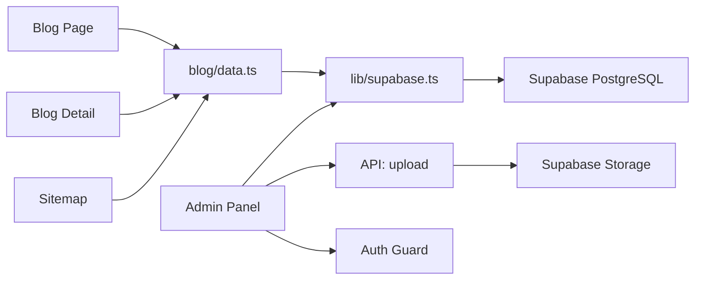

# Requirements

### Overview & Goals
Migrasi blog dari Sanity CMS ke backend sendiri menggunakan Supabase (PostgreSQL) + Supabase Storage untuk gambar, dengan konten blog ditulis dalam MDX. Membuat custom admin panel di Next.js untuk mengelola blog posts. Menghapus semua dependensi Sanity.

### Scope

#### In Scope
- **Database Setup**: Buat table `posts` di Supabase dengan schema yang sesuai
- **Storage Setup**: Buat bucket `blog-images` di Supabase Storage
- **Blog Data Layer**: Ganti Sanity client dengan Supabase client, update queries
- **MDX Rendering**: Ganti PortableTextRenderer dengan MDX renderer
- **Custom Admin Panel**: Halaman `/admin` dengan auth sederhana untuk CRUD blog posts + image upload
- **Remove Sanity**: Hapus dependensi `next-sanity`, `@sanity/image-url`, `@portabletext/react`
- **Clean Up**: Hapus file Sanity yang tidak diperlukan (lib/sanity.ts, lib/Queries.ts)

#### Out of Scope
- Migrasi data existing dari Sanity ke Supabase (manual via Supabase Studio)
- Role-based access control (admin auth sederhana saja)
- Draft/review workflow
- Multi-author support

### Key Decisions
- **MDX untuk konten**: Blog body disimpan sebagai MDX string di database, di-render dengan `next-mdx-remote`
- **Supabase Storage untuk gambar**: Upload via admin panel, URL publik disimpan di database
- **Custom admin di Next.js**: Halaman `/admin` dengan password protection sederhana (env var)
- **PostgreSQL di Supabase**: Relational database, serverless-friendly, gratis tier 500MB
- **Image handling**: BlogCard dan BlogPostDetail sekarang menggunakan URL string langsung (bukan Sanity image builder)

### Data Model

**Table `posts`:**
| Column | Type | Description |
|--------|------|-------------|
| id | uuid (primary key) | Auto-generated |
| title | text | Judul blog post |
| slug | text (unique) | URL slug |
| body_mdx | text | Konten MDX |
| excerpt | text | Ringkasan singkat |
| main_image_url | text (nullable) | URL gambar utama dari Supabase Storage |
| published_at | timestamptz | Waktu publish |
| created_at | timestamptz | Auto-generated |
| updated_at | timestamptz | Auto-generated |

**Storage Bucket `blog-images`:**
- Public bucket untuk akses langsung
- Files stored as: `{post_id}/{filename}`

# Technical Design

### Current Implementation

**Sanity Dependencies:**
- `next-sanity` — client + SSG helpers
- `@sanity/image-url` — URL builder untuk gambar
- `@portabletext/react` — render PortableText blocks

**Files to Modify:**
- `lib/sanity.ts` → REPLACE dengan `lib/supabase.ts`
- `lib/Queries.ts` → DELETE (queries langsung di data.ts)
- `lib/types.ts` → UPDATE: Post interface tanpa Sanity-specific fields
- `lib/env.ts` → UPDATE: validasi env vars Supabase
- `src/features/blog/data.ts` → REPLACE: fetch dari Supabase
- `src/features/blog/components/PortableTextRenderer.tsx` → REPLACE dengan `MdxRenderer.tsx`
- `src/features/blog/components/BlogCard.tsx` → UPDATE: gambar dari URL string
- `src/features/blog/components/BlogPostDetail.tsx` → UPDATE: gambar dari URL string, hapus urlFor
- `app/[locale]/blog/[slug]/page.tsx` → UPDATE: hapus urlFor import
- `app/sitemap.ts` → UPDATE: fetch slugs dari Supabase

**Files to Delete:**
- `lib/sanity.ts`
- `lib/Queries.ts`

**Files to Add:**
- `lib/supabase.ts` — Supabase client
- `src/features/blog/components/MdxRenderer.tsx` — MDX renderer
- `app/admin/layout.tsx` — Admin layout dengan auth guard
- `app/admin/page.tsx` — Admin dashboard (list posts)
- `app/admin/posts/new/page.tsx` — Create post form
- `app/admin/posts/[id]/edit/page.tsx` — Edit post form
- `app/api/admin/auth/route.ts` — Admin auth endpoint
- `app/api/blog/upload/route.ts` — Image upload endpoint
- `app/api/blog/posts/route.ts` — API untuk CRUD posts

### Architecture Diagram

### Proposed Changes

#### Stage 1: Database & Supabase Client
- Buat table `posts` di Supabase via SQL migration
- Buat bucket `blog-images` (public)
- Buat `lib/supabase.ts` dengan `@supabase/supabase-js` client
- Update `lib/env.ts` untuk validasi `NEXT_PUBLIC_SUPABASE_URL` dan `NEXT_PUBLIC_SUPABASE_ANON_KEY`
- Update `lib/types.ts`: Post interface baru (id, title, slug, body_mdx, excerpt, main_image_url, published_at)
- Update `lib/types.test.ts`: test type guard baru

#### Stage 2: Blog Data Layer & MDX Renderer
- Ganti `src/features/blog/data.ts` untuk fetch dari Supabase
- Buat `src/features/blog/components/MdxRenderer.tsx` menggunakan `next-mdx-remote`
- Update `BlogCard.tsx`: gambar dari URL string langsung
- Update `BlogPostDetail.tsx`: gambar dari URL string, pakai MdxRenderer
- Update `app/[locale]/blog/[slug]/page.tsx`: hapus urlFor, gunakan image URL langsung
- Update `app/sitemap.ts`: fetch slugs dari Supabase
- Update `src/features/blog/index.ts`: export MdxRenderer, hapus PortableTextRenderer

#### Stage 3: Admin Panel
- Buat admin layout dengan auth guard (password dari env var `ADMIN_PASSWORD`)
- Buat admin dashboard (list semua posts dengan CRUD actions)
- Buat form create/edit post dengan MDX editor
- Buat API route untuk upload image ke Supabase Storage
- Buat API route untuk auth admin
- Tambahkan route guards agar `/admin` tidak di-include di sitemap

#### Stage 4: Cleanup & Validation
- Hapus `lib/sanity.ts` dan `lib/Queries.ts`
- Hapus dependensi `next-sanity`, `@sanity/image-url`, `@portabletext/react` dari package.json
- Tambahkan dependensi `@supabase/supabase-js` dan `next-mdx-remote`
- Update `AGENTS.md` dan `README.md` dengan arsitektur baru
- Jalankan `npm run check` untuk validasi
- Update env.example atau dokumentasi dengan env vars baru

# Delivery Steps

### ✓ Step 1: Setup Supabase Database and Client
Buat database schema di Supabase dan setup client di kode.
- Buat table `posts` di Supabase (id, title, slug, body_mdx, excerpt, main_image_url, published_at, created_at, updated_at)
- Buat storage bucket `blog-images` (public) di Supabase
- Buat `lib/supabase.ts` dengan Supabase client dari `@supabase/supabase-js`
- Update `lib/env.ts`: ganti validasi Sanity dengan `NEXT_PUBLIC_SUPABASE_URL` dan `NEXT_PUBLIC_SUPABASE_ANON_KEY`
- Update `lib/types.ts`: Post interface baru (id: string, title: string, slug: string, body_mdx: string, excerpt?: string, main_image_url?: string, published_at?: string)
- Update `lib/types.test.ts`: test type guard untuk Post baru
- Install `@supabase/supabase-js` dependency

### ✓ Step 2: Replace Blog Data Layer and MDX Renderer
Ganti Sanity queries dengan Supabase fetch, ganti PortableText dengan MDX renderer.
- Ganti `src/features/blog/data.ts`: getPosts(), getPostBySlug(), getPostSlugs() sekarang fetch dari Supabase
- Buat `src/features/blog/components/MdxRenderer.tsx` menggunakan `next-mdx-remote` (MDXRemote)
- Update `BlogCard.tsx`: ganti `urlFor(post.mainImage)` dengan `post.main_image_url` langsung
- Update `BlogPostDetail.tsx`: ganti PortableTextRenderer dengan MdxRenderer, gambar dari URL string
- Update `app/[locale]/blog/[slug]/page.tsx`: hapus import `urlFor`, gunakan `post.main_image_url` untuk metadata
- Update `app/sitemap.ts`: fetch slugs dari Supabase (ganti error message dari Sanity ke Supabase)
- Update `src/features/blog/index.ts`: export MdxRenderer, hapus PortableTextRenderer
- Install `next-mdx-remote` dependency

### ✓ Step 3: Build Custom Admin Panel
Buat admin panel untuk CRUD blog posts dan upload gambar.
- Buat `app/admin/layout.tsx` dengan auth guard (password dari env var `ADMIN_PASSWORD`)
- Buat `app/admin/page.tsx` — dashboard list posts dengan tombol create/edit/delete
- Buat `app/admin/posts/new/page.tsx` — form create post (title, slug, excerpt, MDX body, image upload)
- Buat `app/admin/posts/[id]/edit/page.tsx` — form edit post (pre-filled)
- Buat `app/api/admin/auth/route.ts` — verify admin password, set cookie session
- Buat `app/api/blog/upload/route.ts` — upload image ke Supabase Storage, return URL
- Buat `app/api/blog/posts/route.ts` — API untuk CRUD posts (GET, POST, PUT, DELETE)
- Tambahkan `ADMIN_PASSWORD` ke env validation di `lib/env.ts`
- Pastikan `/admin` tidak masuk sitemap dan di-disallow di robots.txt

### ✓ Step 4: Remove Sanity and Validate
Hapus semua dependensi dan file Sanity, validasi final.
- Hapus `lib/sanity.ts` dan `lib/Queries.ts`
- Hapus dependensi `next-sanity`, `@sanity/image-url`, `@portabletext/react` dari package.json
- Update `AGENTS.md`: ganti section Sanity CMS dengan Supabase + MDX, update repository structure
- Update `README.md`: ganti section CMS dengan Supabase, tambahkan env vars baru
- Update `app/Robots.ts`: tambahkan disallow `/admin`
- Jalankan `npm run check` untuk validasi final (ESLint, TypeScript, 15 tests)
- Pastikan tidak ada import Sanity yang tersisa
